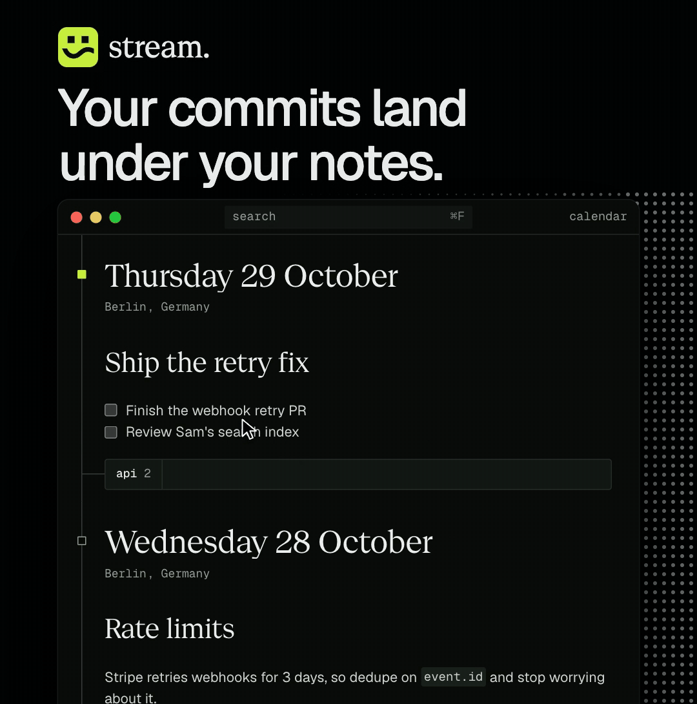

<p align="center">
  
</p>

<h1 align="center">stream</h1>

<p align="center">
  Daily notes for engineers. Your commits, pull requests and agents show up under each day.
</p>

<p align="center">
  <a href="https://github.com/marcelmarais/stream/releases/latest/download/stream-latest-macos-arm64.dmg"><strong>Download for Mac</strong></a>
  ·
  <a href="https://www.differentiated.io/stream">Website</a>
</p>

<p align="center">
  
</p>

## What it does

- **Your commits under your notes.** Stream finds the git repos on your Mac. Connect the ones you care about and each day lists what you committed, grouped by repo and branch.
- **Pull requests and checks.** Your open pull requests sit on today's note with their checks and reviews. Colour only appears when something needs you.
- **Your agents.** Claude Code and Codex sessions appear next to the branch they're working on. Hover to see what each one is doing, click to open its chat, and look for the lime dot when one is waiting for you. Stream only reads session files on your Mac.
- **Skills.** Drop skills into the `Skills` folder next to your notes and type `/` in a note to run one. Claude Code or Codex starts on it in the background, knows which note and line you were on, and its edits appear in the note as it works. Skills use the same `SKILL.md` format as both tools, so you can copy yours straight in.
- **One note a day.** Every day gets its own markdown file, all in one long timeline. Jump to any date from the calendar.
- **Markdown that formats as you type.** The symbols disappear as you write and come back when your cursor reaches them. Links collapse into a small chip with the site's icon.
- **Collapsible headings.** Click the arrow beside a heading to fold its section. Stream remembers what you folded, and the file itself never changes.
- **Search.** ⌘F searches every note as you type.
- **Plain files.** Notes are `YYYY-MM-DD.md` files in a folder you choose, so anything that reads markdown can read them.

## Getting started

1. [Download the app](https://github.com/marcelmarais/stream/releases/latest/download/stream-latest-macos-arm64.dmg), open the DMG and drag Stream to Applications. It needs an Apple silicon Mac and updates itself.
2. Pick a folder for your notes.
3. Open **settings** and connect your repos.

Pull requests and checks come through the [GitHub CLI](https://cli.github.com), so install it and run `gh auth login` to see them. Settings shows whether the connection is working. If gh is signed in to more than one account, Settings also lets you choose which one Stream uses for your repositories and which one syncs your notes, whichever is active in gh.

## Shortcuts

| Shortcut | Action                        |
| -------- | ----------------------------- |
| ⌘F       | Search your notes             |
| ⌘S       | Save and format with Prettier |
| ⌘O       | Focus on the current note     |
| ⌘.       | Fold or unfold a heading      |

## Development

Stream is a [Tauri 2](https://tauri.app) app with a Next.js frontend and a Rust backend. You'll need Node, pnpm and Rust. The app lives in `stream/`.

```bash
cd stream
pnpm install
pnpm tauri dev
```

Before you push:

```bash
pnpm check
pnpm type-check
cargo test --manifest-path src-tauri/Cargo.toml
```

To see the frontend without building the app, `pnpm screenshots` renders every screen in Chromium on fake data. See [AGENTS.md](AGENTS.md#previewing-the-ui).

To release, see [AGENTS.md](AGENTS.md).
